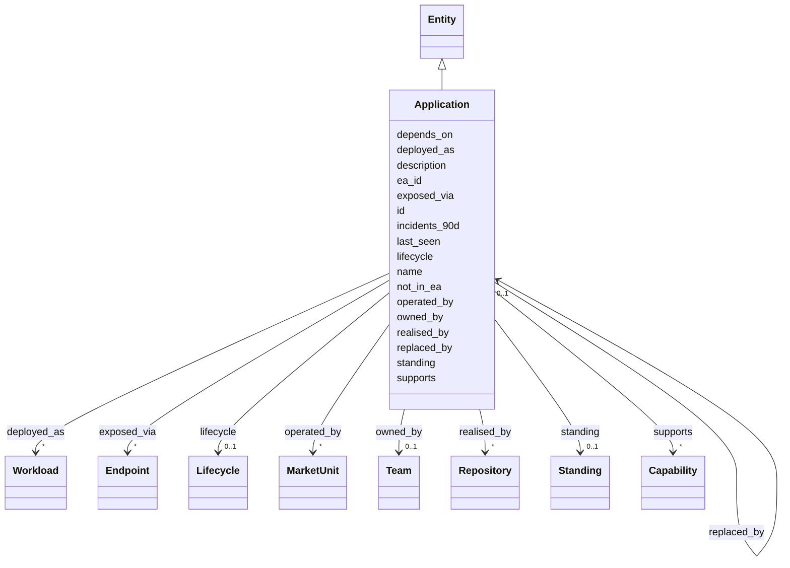

---
search:
  boost: 10.0
---

# Class: Application 


_A thing the business recognises as one system, however many parts it has._


<div data-search-exclude markdown="1">


URI: [ctx:Application](https://example.org/it-intelligence/Application)





## Inheritance
* [Entity](Entity.md)
    * **Application**


## Slots

| Name | Cardinality and Range | Description | Inheritance |
| ---  | --- | --- | --- |
| [realised_by](realised_by.md) | * <br/> [Repository](Repository.md) | The application is implemented in this repository | direct |
| [deployed_as](deployed_as.md) | * <br/> [Workload](Workload.md) | The application runs as this workload | direct |
| [owned_by](owned_by.md) | 0..1 <br/> [Team](Team.md) | The accountable team | direct |
| [operated_by](operated_by.md) | * <br/> [MarketUnit](MarketUnit.md) | The application is operated by, and serves, this market unit | direct |
| [supports](supports.md) | * <br/> [Capability](Capability.md) | The application supports this business capability | direct |
| [exposed_via](exposed_via.md) | * <br/> [Endpoint](Endpoint.md) | The application is reachable through this endpoint | direct |
| [depends_on](depends_on.md) | * <br/> [Application](Application.md) | The application calls, or needs, this other application | direct |
| [replaced_by](replaced_by.md) | 0..1 <br/> [Application](Application.md) | The application is, or will be, replaced by this successor | direct |
| [lifecycle](lifecycle.md) | 0..1 <br/> [Lifecycle](Lifecycle.md) |  | direct |
| [description](description.md) | 0..1 <br/> [String](String.md) |  | direct |
| [ea_id](ea_id.md) | 0..1 <br/> [String](String.md) | The application id in the EA repository, when it has one | direct |
| [not_in_ea](not_in_ea.md) | 0..1 <br/> [Boolean](Boolean.md) | True when no EA repository record backs the application | direct |
| [incidents_90d](incidents_90d.md) | 0..1 <br/> [Integer](Integer.md) | Incidents in the last 90 days, from IT service management | direct |
| [id](id.md) | 1 <br/> [String](String.md) | The Context Model id, for example ctx:Application/policy-admin | [Entity](Entity.md) |
| [name](name.md) | 1 <br/> [String](String.md) |  | [Entity](Entity.md) |
| [standing](standing.md) | 0..1 <br/> [Standing](Standing.md) |  | [Entity](Entity.md) |
| [last_seen](last_seen.md) | 0..1 <br/> [Datetime](Datetime.md) |  | [Entity](Entity.md) |


## Usages

| used by | used in | type | used |
| ---  | --- | --- | --- |
| [Application](Application.md) | [realised_by](realised_by.md) | domain | [Application](Application.md) |
| [Application](Application.md) | [deployed_as](deployed_as.md) | domain | [Application](Application.md) |
| [Application](Application.md) | [operated_by](operated_by.md) | domain | [Application](Application.md) |
| [Application](Application.md) | [supports](supports.md) | domain | [Application](Application.md) |
| [Application](Application.md) | [exposed_via](exposed_via.md) | domain | [Application](Application.md) |
| [Application](Application.md) | [depends_on](depends_on.md) | domain | [Application](Application.md) |
| [Application](Application.md) | [depends_on](depends_on.md) | range | [Application](Application.md) |
| [Application](Application.md) | [replaced_by](replaced_by.md) | domain | [Application](Application.md) |
| [Application](Application.md) | [replaced_by](replaced_by.md) | range | [Application](Application.md) |


## Identifier and Mapping Information


### Annotations

| property | value |
| --- | --- |
| ctx_id_pattern | {short_name} |


### Schema Source


* from schema: https://example.org/it-intelligence/context-model


## Mappings

| Mapping Type | Mapped Value |
| ---  | ---  |
| self | ctx:Application |
| native | ctx:Application |


## LinkML Source

<!-- TODO: investigate https://stackoverflow.com/questions/37606292/how-to-create-tabbed-code-blocks-in-mkdocs-or-sphinx -->

### Direct

<details>
```yaml
name: Application
annotations:
  ctx_id_pattern:
    tag: ctx_id_pattern
    value: '{short_name}'
description: A thing the business recognises as one system, however many parts it
  has.
from_schema: https://example.org/it-intelligence/context-model
is_a: Entity
slots:
- realised_by
- deployed_as
- owned_by
- operated_by
- supports
- exposed_via
- depends_on
- replaced_by
attributes:
  lifecycle:
    name: lifecycle
    from_schema: https://example.org/it-intelligence/entities
    rank: 1000
    domain_of:
    - Application
    range: Lifecycle
  description:
    name: description
    from_schema: https://example.org/it-intelligence/entities
    rank: 1000
    domain_of:
    - Application
    - Repository
  ea_id:
    name: ea_id
    description: The application id in the EA repository, when it has one.
    from_schema: https://example.org/it-intelligence/entities
    rank: 1000
    domain_of:
    - Application
  not_in_ea:
    name: not_in_ea
    description: True when no EA repository record backs the application.
    from_schema: https://example.org/it-intelligence/entities
    rank: 1000
    domain_of:
    - Application
    range: boolean
  incidents_90d:
    name: incidents_90d
    description: Incidents in the last 90 days, from IT service management.
    from_schema: https://example.org/it-intelligence/entities
    rank: 1000
    domain_of:
    - Application
    range: integer

```
</details>

### Induced

<details>
```yaml
name: Application
annotations:
  ctx_id_pattern:
    tag: ctx_id_pattern
    value: '{short_name}'
description: A thing the business recognises as one system, however many parts it
  has.
from_schema: https://example.org/it-intelligence/context-model
is_a: Entity
attributes:
  lifecycle:
    name: lifecycle
    from_schema: https://example.org/it-intelligence/entities
    rank: 1000
    owner: Application
    domain_of:
    - Application
    range: Lifecycle
  description:
    name: description
    from_schema: https://example.org/it-intelligence/entities
    rank: 1000
    owner: Application
    domain_of:
    - Application
    - Repository
    range: string
  ea_id:
    name: ea_id
    description: The application id in the EA repository, when it has one.
    from_schema: https://example.org/it-intelligence/entities
    rank: 1000
    owner: Application
    domain_of:
    - Application
    range: string
  not_in_ea:
    name: not_in_ea
    description: True when no EA repository record backs the application.
    from_schema: https://example.org/it-intelligence/entities
    rank: 1000
    owner: Application
    domain_of:
    - Application
    range: boolean
  incidents_90d:
    name: incidents_90d
    description: Incidents in the last 90 days, from IT service management.
    from_schema: https://example.org/it-intelligence/entities
    rank: 1000
    owner: Application
    domain_of:
    - Application
    range: integer
  realised_by:
    name: realised_by
    annotations:
      ctx_domain:
        tag: ctx_domain
        value: Application
      ctx_range:
        tag: ctx_range
        value: Repository
      ctx_cardinality:
        tag: ctx_cardinality
        value: many
    description: The application is implemented in this repository.
    from_schema: https://example.org/it-intelligence/context-model
    rank: 1000
    domain: Application
    owner: Application
    domain_of:
    - Application
    range: Repository
    multivalued: true
  deployed_as:
    name: deployed_as
    annotations:
      ctx_domain:
        tag: ctx_domain
        value: Application
      ctx_range:
        tag: ctx_range
        value: Workload
      ctx_cardinality:
        tag: ctx_cardinality
        value: many
    description: The application runs as this workload.
    from_schema: https://example.org/it-intelligence/context-model
    rank: 1000
    domain: Application
    owner: Application
    domain_of:
    - Application
    range: Workload
    multivalued: true
  owned_by:
    name: owned_by
    annotations:
      ctx_domain:
        tag: ctx_domain
        value: Application Repository Workload Namespace Endpoint
      ctx_range:
        tag: ctx_range
        value: Team
      ctx_cardinality:
        tag: ctx_cardinality
        value: one
    description: The accountable team.
    from_schema: https://example.org/it-intelligence/context-model
    rank: 1000
    owner: Application
    domain_of:
    - Application
    - Repository
    - Workload
    - Namespace
    - Endpoint
    range: Team
  operated_by:
    name: operated_by
    annotations:
      ctx_domain:
        tag: ctx_domain
        value: Application
      ctx_range:
        tag: ctx_range
        value: MarketUnit
      ctx_cardinality:
        tag: ctx_cardinality
        value: many
    description: The application is operated by, and serves, this market unit.
    from_schema: https://example.org/it-intelligence/context-model
    rank: 1000
    domain: Application
    owner: Application
    domain_of:
    - Application
    range: MarketUnit
    multivalued: true
  supports:
    name: supports
    annotations:
      ctx_domain:
        tag: ctx_domain
        value: Application
      ctx_range:
        tag: ctx_range
        value: Capability
      ctx_cardinality:
        tag: ctx_cardinality
        value: many
    description: The application supports this business capability.
    from_schema: https://example.org/it-intelligence/context-model
    rank: 1000
    domain: Application
    owner: Application
    domain_of:
    - Application
    range: Capability
    multivalued: true
  exposed_via:
    name: exposed_via
    annotations:
      ctx_domain:
        tag: ctx_domain
        value: Application
      ctx_range:
        tag: ctx_range
        value: Endpoint
      ctx_cardinality:
        tag: ctx_cardinality
        value: many
    description: The application is reachable through this endpoint.
    from_schema: https://example.org/it-intelligence/context-model
    rank: 1000
    domain: Application
    owner: Application
    domain_of:
    - Application
    range: Endpoint
    multivalued: true
  depends_on:
    name: depends_on
    annotations:
      ctx_domain:
        tag: ctx_domain
        value: Application
      ctx_range:
        tag: ctx_range
        value: Application
      ctx_cardinality:
        tag: ctx_cardinality
        value: many
    description: The application calls, or needs, this other application.
    from_schema: https://example.org/it-intelligence/context-model
    rank: 1000
    domain: Application
    owner: Application
    domain_of:
    - Application
    range: Application
    multivalued: true
  replaced_by:
    name: replaced_by
    annotations:
      ctx_domain:
        tag: ctx_domain
        value: Application
      ctx_range:
        tag: ctx_range
        value: Application
      ctx_cardinality:
        tag: ctx_cardinality
        value: one
    description: The application is, or will be, replaced by this successor.
    from_schema: https://example.org/it-intelligence/context-model
    rank: 1000
    domain: Application
    owner: Application
    domain_of:
    - Application
    range: Application
  id:
    name: id
    description: The Context Model id, for example ctx:Application/policy-admin.
    from_schema: https://example.org/it-intelligence/context-model
    rank: 1000
    identifier: true
    owner: Application
    domain_of:
    - Entity
    range: string
    required: true
  name:
    name: name
    from_schema: https://example.org/it-intelligence/context-model
    rank: 1000
    owner: Application
    domain_of:
    - Entity
    range: string
    required: true
  standing:
    name: standing
    from_schema: https://example.org/it-intelligence/context-model
    rank: 1000
    owner: Application
    domain_of:
    - Entity
    range: Standing
  last_seen:
    name: last_seen
    from_schema: https://example.org/it-intelligence/context-model
    rank: 1000
    owner: Application
    domain_of:
    - Entity
    range: datetime

```
</details></div>