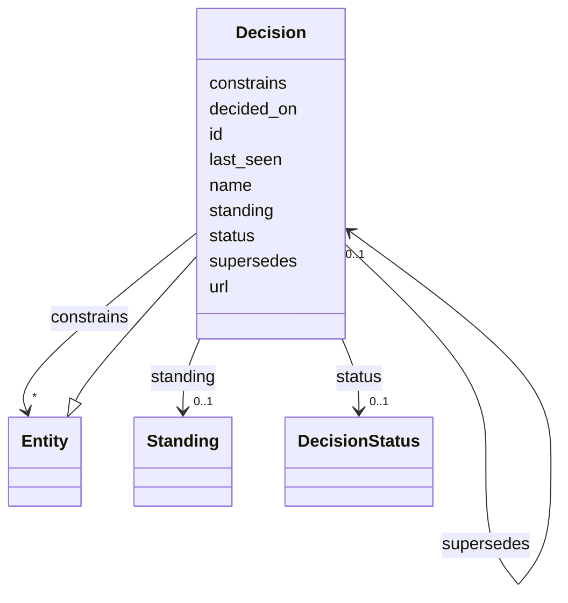

---
search:
  boost: 10.0
---

# Class: Decision 


_An architecture decision record, with the entities it constrains._


<div data-search-exclude markdown="1">


URI: [ctx:Decision](https://example.org/it-intelligence/Decision)





## Inheritance
* [Entity](Entity.md)
    * **Decision**


## Slots

| Name | Cardinality and Range | Description | Inheritance |
| ---  | --- | --- | --- |
| [constrains](constrains.md) | * <br/> [Entity](Entity.md) | The decision applies to this entity | direct |
| [supersedes](supersedes.md) | 0..1 <br/> [Decision](Decision.md) | The decision replaces this earlier decision | direct |
| [status](status.md) | 0..1 <br/> [DecisionStatus](DecisionStatus.md) |  | direct |
| [decided_on](decided_on.md) | 0..1 <br/> [Date](Date.md) |  | direct |
| [url](url.md) | 0..1 <br/> [Uri](Uri.md) |  | direct |
| [id](id.md) | 1 <br/> [String](String.md) | The Context Model id, for example ctx:Application/policy-admin | [Entity](Entity.md) |
| [name](name.md) | 1 <br/> [String](String.md) |  | [Entity](Entity.md) |
| [standing](standing.md) | 0..1 <br/> [Standing](Standing.md) |  | [Entity](Entity.md) |
| [last_seen](last_seen.md) | 0..1 <br/> [Datetime](Datetime.md) |  | [Entity](Entity.md) |


## Usages

| used by | used in | type | used |
| ---  | --- | --- | --- |
| [Decision](Decision.md) | [constrains](constrains.md) | domain | [Decision](Decision.md) |
| [Decision](Decision.md) | [supersedes](supersedes.md) | domain | [Decision](Decision.md) |
| [Decision](Decision.md) | [supersedes](supersedes.md) | range | [Decision](Decision.md) |


## Identifier and Mapping Information


### Annotations

| property | value |
| --- | --- |
| ctx_id_pattern | {repo}/{number} |


### Schema Source


* from schema: https://example.org/it-intelligence/context-model


## Mappings

| Mapping Type | Mapped Value |
| ---  | ---  |
| self | ctx:Decision |
| native | ctx:Decision |


## LinkML Source

<!-- TODO: investigate https://stackoverflow.com/questions/37606292/how-to-create-tabbed-code-blocks-in-mkdocs-or-sphinx -->

### Direct

<details>
```yaml
name: Decision
annotations:
  ctx_id_pattern:
    tag: ctx_id_pattern
    value: '{repo}/{number}'
description: An architecture decision record, with the entities it constrains.
from_schema: https://example.org/it-intelligence/context-model
is_a: Entity
slots:
- constrains
- supersedes
attributes:
  status:
    name: status
    from_schema: https://example.org/it-intelligence/entities
    rank: 1000
    domain_of:
    - Decision
    range: DecisionStatus
  decided_on:
    name: decided_on
    from_schema: https://example.org/it-intelligence/entities
    rank: 1000
    domain_of:
    - Decision
    range: date
  url:
    name: url
    from_schema: https://example.org/it-intelligence/entities
    rank: 1000
    domain_of:
    - Decision
    range: uri

```
</details>

### Induced

<details>
```yaml
name: Decision
annotations:
  ctx_id_pattern:
    tag: ctx_id_pattern
    value: '{repo}/{number}'
description: An architecture decision record, with the entities it constrains.
from_schema: https://example.org/it-intelligence/context-model
is_a: Entity
attributes:
  status:
    name: status
    from_schema: https://example.org/it-intelligence/entities
    rank: 1000
    owner: Decision
    domain_of:
    - Decision
    range: DecisionStatus
  decided_on:
    name: decided_on
    from_schema: https://example.org/it-intelligence/entities
    rank: 1000
    owner: Decision
    domain_of:
    - Decision
    range: date
  url:
    name: url
    from_schema: https://example.org/it-intelligence/entities
    rank: 1000
    owner: Decision
    domain_of:
    - Decision
    range: uri
  constrains:
    name: constrains
    annotations:
      ctx_domain:
        tag: ctx_domain
        value: Decision
      ctx_range:
        tag: ctx_range
        value: Entity
      ctx_cardinality:
        tag: ctx_cardinality
        value: many
    description: The decision applies to this entity.
    from_schema: https://example.org/it-intelligence/context-model
    rank: 1000
    domain: Decision
    owner: Decision
    domain_of:
    - Decision
    range: Entity
    multivalued: true
  supersedes:
    name: supersedes
    annotations:
      ctx_domain:
        tag: ctx_domain
        value: Decision
      ctx_range:
        tag: ctx_range
        value: Decision
      ctx_cardinality:
        tag: ctx_cardinality
        value: one
    description: The decision replaces this earlier decision.
    from_schema: https://example.org/it-intelligence/context-model
    rank: 1000
    domain: Decision
    owner: Decision
    domain_of:
    - Decision
    range: Decision
  id:
    name: id
    description: The Context Model id, for example ctx:Application/policy-admin.
    from_schema: https://example.org/it-intelligence/context-model
    rank: 1000
    identifier: true
    owner: Decision
    domain_of:
    - Entity
    range: string
    required: true
  name:
    name: name
    from_schema: https://example.org/it-intelligence/context-model
    rank: 1000
    owner: Decision
    domain_of:
    - Entity
    range: string
    required: true
  standing:
    name: standing
    from_schema: https://example.org/it-intelligence/context-model
    rank: 1000
    owner: Decision
    domain_of:
    - Entity
    range: Standing
  last_seen:
    name: last_seen
    from_schema: https://example.org/it-intelligence/context-model
    rank: 1000
    owner: Decision
    domain_of:
    - Entity
    range: datetime

```
</details></div>