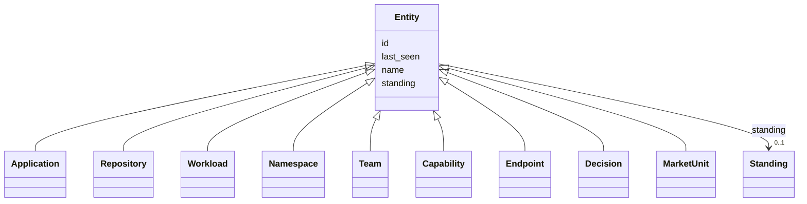

---
search:
  boost: 10.0
---

# Class: Entity 


_Something the Context Model concluded exists, from one or more observations._


<div data-search-exclude markdown="1">


* __NOTE__: this is an abstract class and should not be instantiated directly


URI: [ctx:Entity](https://example.org/it-intelligence/Entity)





## Inheritance
* **Entity**
    * [Application](Application.md)
    * [Repository](Repository.md)
    * [Workload](Workload.md)
    * [Namespace](Namespace.md)
    * [Team](Team.md)
    * [Capability](Capability.md)
    * [Endpoint](Endpoint.md)
    * [Decision](Decision.md)
    * [MarketUnit](MarketUnit.md)


## Slots

| Name | Cardinality and Range | Description | Inheritance |
| ---  | --- | --- | --- |
| [id](id.md) | 1 <br/> [String](String.md) | The Context Model id, for example ctx:Application/policy-admin | direct |
| [name](name.md) | 1 <br/> [String](String.md) |  | direct |
| [standing](standing.md) | 0..1 <br/> [Standing](Standing.md) |  | direct |
| [last_seen](last_seen.md) | 0..1 <br/> [Datetime](Datetime.md) |  | direct |


## Usages

| used by | used in | type | used |
| ---  | --- | --- | --- |
| [Decision](Decision.md) | [constrains](constrains.md) | range | [Entity](Entity.md) |


## Identifier and Mapping Information


### Schema Source


* from schema: https://example.org/it-intelligence/context-model


## Mappings

| Mapping Type | Mapped Value |
| ---  | ---  |
| self | ctx:Entity |
| native | ctx:Entity |


## LinkML Source

<!-- TODO: investigate https://stackoverflow.com/questions/37606292/how-to-create-tabbed-code-blocks-in-mkdocs-or-sphinx -->

### Direct

<details>
```yaml
name: Entity
description: Something the Context Model concluded exists, from one or more observations.
from_schema: https://example.org/it-intelligence/context-model
abstract: true
slots:
- id
- name
- standing
- last_seen

```
</details>

### Induced

<details>
```yaml
name: Entity
description: Something the Context Model concluded exists, from one or more observations.
from_schema: https://example.org/it-intelligence/context-model
abstract: true
attributes:
  id:
    name: id
    description: The Context Model id, for example ctx:Application/policy-admin.
    from_schema: https://example.org/it-intelligence/context-model
    rank: 1000
    identifier: true
    owner: Entity
    domain_of:
    - Entity
    range: string
    required: true
  name:
    name: name
    from_schema: https://example.org/it-intelligence/context-model
    rank: 1000
    owner: Entity
    domain_of:
    - Entity
    range: string
    required: true
  standing:
    name: standing
    from_schema: https://example.org/it-intelligence/context-model
    rank: 1000
    owner: Entity
    domain_of:
    - Entity
    range: Standing
  last_seen:
    name: last_seen
    from_schema: https://example.org/it-intelligence/context-model
    rank: 1000
    owner: Entity
    domain_of:
    - Entity
    range: datetime

```
</details></div>