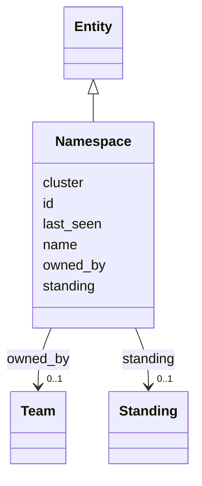

---
search:
  boost: 10.0
---

# Class: Namespace 


_A namespace on a container cluster._


<div data-search-exclude markdown="1">


URI: [ctx:Namespace](https://example.org/it-intelligence/Namespace)





## Inheritance
* [Entity](Entity.md)
    * **Namespace**


## Slots

| Name | Cardinality and Range | Description | Inheritance |
| ---  | --- | --- | --- |
| [owned_by](owned_by.md) | 0..1 <br/> [Team](Team.md) | The accountable team | direct |
| [cluster](cluster.md) | 0..1 <br/> [String](String.md) |  | direct |
| [id](id.md) | 1 <br/> [String](String.md) | The Context Model id, for example ctx:Application/policy-admin | [Entity](Entity.md) |
| [name](name.md) | 1 <br/> [String](String.md) |  | [Entity](Entity.md) |
| [standing](standing.md) | 0..1 <br/> [Standing](Standing.md) |  | [Entity](Entity.md) |
| [last_seen](last_seen.md) | 0..1 <br/> [Datetime](Datetime.md) |  | [Entity](Entity.md) |


## Usages

| used by | used in | type | used |
| ---  | --- | --- | --- |
| [Workload](Workload.md) | [runs_in](runs_in.md) | range | [Namespace](Namespace.md) |


## Identifier and Mapping Information


### Annotations

| property | value |
| --- | --- |
| ctx_id_pattern | {name} |


### Schema Source


* from schema: https://example.org/it-intelligence/context-model


## Mappings

| Mapping Type | Mapped Value |
| ---  | ---  |
| self | ctx:Namespace |
| native | ctx:Namespace |


## LinkML Source

<!-- TODO: investigate https://stackoverflow.com/questions/37606292/how-to-create-tabbed-code-blocks-in-mkdocs-or-sphinx -->

### Direct

<details>
```yaml
name: Namespace
annotations:
  ctx_id_pattern:
    tag: ctx_id_pattern
    value: '{name}'
description: A namespace on a container cluster.
from_schema: https://example.org/it-intelligence/context-model
is_a: Entity
slots:
- owned_by
attributes:
  cluster:
    name: cluster
    from_schema: https://example.org/it-intelligence/entities
    rank: 1000
    domain_of:
    - Namespace

```
</details>

### Induced

<details>
```yaml
name: Namespace
annotations:
  ctx_id_pattern:
    tag: ctx_id_pattern
    value: '{name}'
description: A namespace on a container cluster.
from_schema: https://example.org/it-intelligence/context-model
is_a: Entity
attributes:
  cluster:
    name: cluster
    from_schema: https://example.org/it-intelligence/entities
    rank: 1000
    owner: Namespace
    domain_of:
    - Namespace
    range: string
  owned_by:
    name: owned_by
    annotations:
      ctx_domain:
        tag: ctx_domain
        value: Application Repository Workload Namespace Endpoint
      ctx_range:
        tag: ctx_range
        value: Team
      ctx_cardinality:
        tag: ctx_cardinality
        value: one
    description: The accountable team.
    from_schema: https://example.org/it-intelligence/context-model
    rank: 1000
    owner: Namespace
    domain_of:
    - Application
    - Repository
    - Workload
    - Namespace
    - Endpoint
    range: Team
  id:
    name: id
    description: The Context Model id, for example ctx:Application/policy-admin.
    from_schema: https://example.org/it-intelligence/context-model
    rank: 1000
    identifier: true
    owner: Namespace
    domain_of:
    - Entity
    range: string
    required: true
  name:
    name: name
    from_schema: https://example.org/it-intelligence/context-model
    rank: 1000
    owner: Namespace
    domain_of:
    - Entity
    range: string
    required: true
  standing:
    name: standing
    from_schema: https://example.org/it-intelligence/context-model
    rank: 1000
    owner: Namespace
    domain_of:
    - Entity
    range: Standing
  last_seen:
    name: last_seen
    from_schema: https://example.org/it-intelligence/context-model
    rank: 1000
    owner: Namespace
    domain_of:
    - Entity
    range: datetime

```
</details></div>