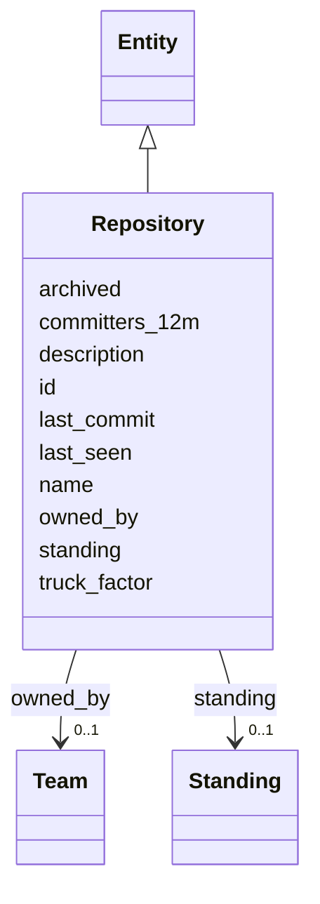

---
search:
  boost: 10.0
---

# Class: Repository 


_A code repository on the git host._


<div data-search-exclude markdown="1">


URI: [ctx:Repository](https://example.org/it-intelligence/Repository)





## Inheritance
* [Entity](Entity.md)
    * **Repository**


## Slots

| Name | Cardinality and Range | Description | Inheritance |
| ---  | --- | --- | --- |
| [owned_by](owned_by.md) | 0..1 <br/> [Team](Team.md) | The accountable team | direct |
| [description](description.md) | 0..1 <br/> [String](String.md) |  | direct |
| [last_commit](last_commit.md) | 0..1 <br/> [Datetime](Datetime.md) |  | direct |
| [committers_12m](committers_12m.md) | 0..1 <br/> [Integer](Integer.md) | Distinct committers in the last twelve months | direct |
| [truck_factor](truck_factor.md) | 0..1 <br/> [Integer](Integer.md) | People who would have to leave before the repository stalls | direct |
| [archived](archived.md) | 0..1 <br/> [Boolean](Boolean.md) | The git host marks the repository read-only | direct |
| [id](id.md) | 1 <br/> [String](String.md) | The Context Model id, for example ctx:Application/policy-admin | [Entity](Entity.md) |
| [name](name.md) | 1 <br/> [String](String.md) |  | [Entity](Entity.md) |
| [standing](standing.md) | 0..1 <br/> [Standing](Standing.md) |  | [Entity](Entity.md) |
| [last_seen](last_seen.md) | 0..1 <br/> [Datetime](Datetime.md) |  | [Entity](Entity.md) |


## Usages

| used by | used in | type | used |
| ---  | --- | --- | --- |
| [Application](Application.md) | [realised_by](realised_by.md) | range | [Repository](Repository.md) |
| [Workload](Workload.md) | [built_from](built_from.md) | range | [Repository](Repository.md) |


## Identifier and Mapping Information


### Annotations

| property | value |
| --- | --- |
| ctx_id_pattern | {org}/{name} |


### Schema Source


* from schema: https://example.org/it-intelligence/context-model


## Mappings

| Mapping Type | Mapped Value |
| ---  | ---  |
| self | ctx:Repository |
| native | ctx:Repository |


## LinkML Source

<!-- TODO: investigate https://stackoverflow.com/questions/37606292/how-to-create-tabbed-code-blocks-in-mkdocs-or-sphinx -->

### Direct

<details>
```yaml
name: Repository
annotations:
  ctx_id_pattern:
    tag: ctx_id_pattern
    value: '{org}/{name}'
description: A code repository on the git host.
from_schema: https://example.org/it-intelligence/context-model
is_a: Entity
slots:
- owned_by
attributes:
  description:
    name: description
    from_schema: https://example.org/it-intelligence/entities
    domain_of:
    - Application
    - Repository
  last_commit:
    name: last_commit
    from_schema: https://example.org/it-intelligence/entities
    rank: 1000
    domain_of:
    - Repository
    range: datetime
  committers_12m:
    name: committers_12m
    description: Distinct committers in the last twelve months.
    from_schema: https://example.org/it-intelligence/entities
    rank: 1000
    domain_of:
    - Repository
    range: integer
  truck_factor:
    name: truck_factor
    description: People who would have to leave before the repository stalls.
    from_schema: https://example.org/it-intelligence/entities
    rank: 1000
    domain_of:
    - Repository
    range: integer
  archived:
    name: archived
    description: The git host marks the repository read-only.
    from_schema: https://example.org/it-intelligence/entities
    rank: 1000
    domain_of:
    - Repository
    range: boolean

```
</details>

### Induced

<details>
```yaml
name: Repository
annotations:
  ctx_id_pattern:
    tag: ctx_id_pattern
    value: '{org}/{name}'
description: A code repository on the git host.
from_schema: https://example.org/it-intelligence/context-model
is_a: Entity
attributes:
  description:
    name: description
    from_schema: https://example.org/it-intelligence/entities
    owner: Repository
    domain_of:
    - Application
    - Repository
    range: string
  last_commit:
    name: last_commit
    from_schema: https://example.org/it-intelligence/entities
    rank: 1000
    owner: Repository
    domain_of:
    - Repository
    range: datetime
  committers_12m:
    name: committers_12m
    description: Distinct committers in the last twelve months.
    from_schema: https://example.org/it-intelligence/entities
    rank: 1000
    owner: Repository
    domain_of:
    - Repository
    range: integer
  truck_factor:
    name: truck_factor
    description: People who would have to leave before the repository stalls.
    from_schema: https://example.org/it-intelligence/entities
    rank: 1000
    owner: Repository
    domain_of:
    - Repository
    range: integer
  archived:
    name: archived
    description: The git host marks the repository read-only.
    from_schema: https://example.org/it-intelligence/entities
    rank: 1000
    owner: Repository
    domain_of:
    - Repository
    range: boolean
  owned_by:
    name: owned_by
    annotations:
      ctx_domain:
        tag: ctx_domain
        value: Application Repository Workload Namespace Endpoint
      ctx_range:
        tag: ctx_range
        value: Team
      ctx_cardinality:
        tag: ctx_cardinality
        value: one
    description: The accountable team.
    from_schema: https://example.org/it-intelligence/context-model
    rank: 1000
    owner: Repository
    domain_of:
    - Application
    - Repository
    - Workload
    - Namespace
    - Endpoint
    range: Team
  id:
    name: id
    description: The Context Model id, for example ctx:Application/policy-admin.
    from_schema: https://example.org/it-intelligence/context-model
    rank: 1000
    identifier: true
    owner: Repository
    domain_of:
    - Entity
    range: string
    required: true
  name:
    name: name
    from_schema: https://example.org/it-intelligence/context-model
    rank: 1000
    owner: Repository
    domain_of:
    - Entity
    range: string
    required: true
  standing:
    name: standing
    from_schema: https://example.org/it-intelligence/context-model
    rank: 1000
    owner: Repository
    domain_of:
    - Entity
    range: Standing
  last_seen:
    name: last_seen
    from_schema: https://example.org/it-intelligence/context-model
    rank: 1000
    owner: Repository
    domain_of:
    - Entity
    range: datetime

```
</details></div>