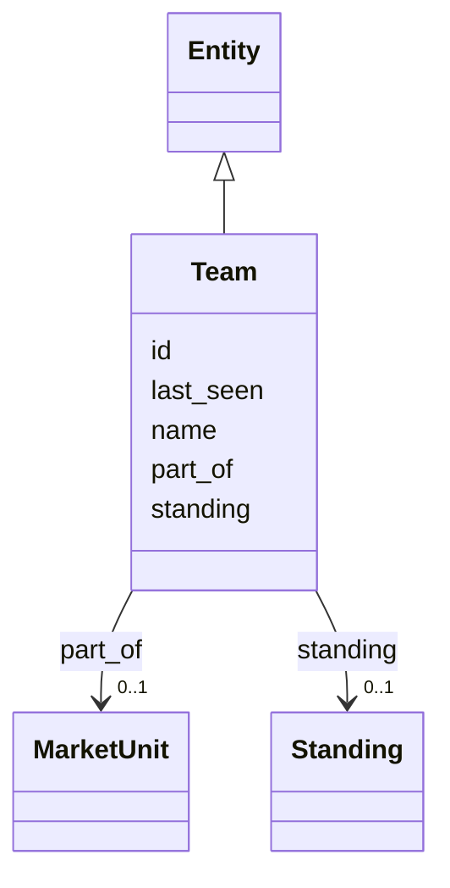

---
search:
  boost: 10.0
---

# Class: Team 


_An accountable team._


<div data-search-exclude markdown="1">


URI: [ctx:Team](https://example.org/it-intelligence/Team)





## Inheritance
* [Entity](Entity.md)
    * **Team**


## Slots

| Name | Cardinality and Range | Description | Inheritance |
| ---  | --- | --- | --- |
| [part_of](part_of.md) | 0..1 <br/> [MarketUnit](MarketUnit.md) | The team belongs to this market unit | direct |
| [id](id.md) | 1 <br/> [String](String.md) | The Context Model id, for example ctx:Application/policy-admin | [Entity](Entity.md) |
| [name](name.md) | 1 <br/> [String](String.md) |  | [Entity](Entity.md) |
| [standing](standing.md) | 0..1 <br/> [Standing](Standing.md) |  | [Entity](Entity.md) |
| [last_seen](last_seen.md) | 0..1 <br/> [Datetime](Datetime.md) |  | [Entity](Entity.md) |


## Usages

| used by | used in | type | used |
| ---  | --- | --- | --- |
| [Application](Application.md) | [owned_by](owned_by.md) | range | [Team](Team.md) |
| [Repository](Repository.md) | [owned_by](owned_by.md) | range | [Team](Team.md) |
| [Workload](Workload.md) | [owned_by](owned_by.md) | range | [Team](Team.md) |
| [Namespace](Namespace.md) | [owned_by](owned_by.md) | range | [Team](Team.md) |
| [Team](Team.md) | [part_of](part_of.md) | domain | [Team](Team.md) |
| [Endpoint](Endpoint.md) | [owned_by](owned_by.md) | range | [Team](Team.md) |


## Identifier and Mapping Information


### Annotations

| property | value |
| --- | --- |
| ctx_id_pattern | {slug} |


### Schema Source


* from schema: https://example.org/it-intelligence/context-model


## Mappings

| Mapping Type | Mapped Value |
| ---  | ---  |
| self | ctx:Team |
| native | ctx:Team |


## LinkML Source

<!-- TODO: investigate https://stackoverflow.com/questions/37606292/how-to-create-tabbed-code-blocks-in-mkdocs-or-sphinx -->

### Direct

<details>
```yaml
name: Team
annotations:
  ctx_id_pattern:
    tag: ctx_id_pattern
    value: '{slug}'
description: An accountable team.
from_schema: https://example.org/it-intelligence/context-model
is_a: Entity
slots:
- part_of

```
</details>

### Induced

<details>
```yaml
name: Team
annotations:
  ctx_id_pattern:
    tag: ctx_id_pattern
    value: '{slug}'
description: An accountable team.
from_schema: https://example.org/it-intelligence/context-model
is_a: Entity
attributes:
  part_of:
    name: part_of
    annotations:
      ctx_domain:
        tag: ctx_domain
        value: Team
      ctx_range:
        tag: ctx_range
        value: MarketUnit
      ctx_cardinality:
        tag: ctx_cardinality
        value: one
    description: The team belongs to this market unit.
    from_schema: https://example.org/it-intelligence/context-model
    rank: 1000
    domain: Team
    owner: Team
    domain_of:
    - Team
    range: MarketUnit
  id:
    name: id
    description: The Context Model id, for example ctx:Application/policy-admin.
    from_schema: https://example.org/it-intelligence/context-model
    rank: 1000
    identifier: true
    owner: Team
    domain_of:
    - Entity
    range: string
    required: true
  name:
    name: name
    from_schema: https://example.org/it-intelligence/context-model
    rank: 1000
    owner: Team
    domain_of:
    - Entity
    range: string
    required: true
  standing:
    name: standing
    from_schema: https://example.org/it-intelligence/context-model
    rank: 1000
    owner: Team
    domain_of:
    - Entity
    range: Standing
  last_seen:
    name: last_seen
    from_schema: https://example.org/it-intelligence/context-model
    rank: 1000
    owner: Team
    domain_of:
    - Entity
    range: datetime

```
</details></div>